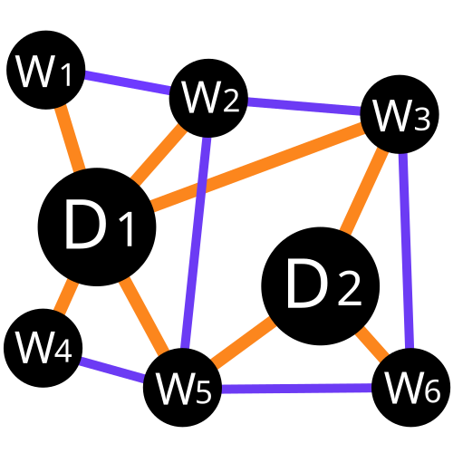
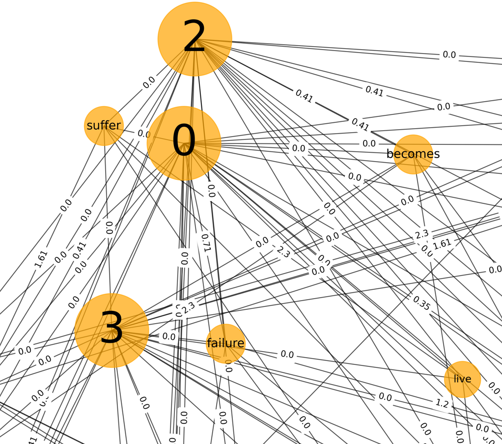

<div align="center">
  
  <h1 style="margin-bottom:40px; margin-top:20px">Text4GCN</h1>
  <p>A Python framework for text classification using Graph Neural Networks</p>
</div>

-----------------

[](https://opensource.org/licenses/MIT)
[](https://badge.fury.io/py/text4gcn)
[](https://www.python.org/downloads/)
[](https://github.com/vitormeriat/text4gcn/actions)
[](https://codecov.io/gh/vitormeriat/text4gcn)
[](https://text4gcn.readthedocs.io/)
[](https://colab.research.google.com/github/vitormeriat/text4gcn/blob/master/notebooks/text4gcn.ipynb)

<div id="top"></div>


### **Table of Contents**

<ol>
    <li><a href="#abstract">Abstract</a></li>
    <li><a href="#installation">Installation</a></li>
    <li><a href="#functionalities">Functionalities</a></li>    
    <li><a href="#examples">Examples</a></li>
    <ul>
        <li><a href="#installation">Get Sample Data</a></li>
        <li><a href="#datasets-description">Text Pipeline</a></li>
        <li><a href="#datasets-description">Builder Adjacency</a></li>
    </ul>
    <li><a href="#contributing">Contributing</a></li>
    <li><a href="#license">License</a></li>
    <li><a href="#references">References</a></li>
</ol>

<div style="margin-bottom:60px"></div>

## About

**Text4GCN** is an open-source Python framework that simplifies the generation of text-based graph data for Graph Neural Network (GNN) architectures. The framework's core strength lies in its ability to build memory-optimized text graphs using different text representations to create relationships and define edge weights.

### Key Features

- 🚀 **Easy-to-use API**: Simple and intuitive interface for researchers and practitioners
- 📊 **Multiple Dataset Support**: Built-in support for popular text classification datasets (R8, R52, 20NG, etc.)
- 🔧 **Flexible Graph Building**: Various methods for constructing text graphs (semantic, syntactic, frequency-based)
- 🧠 **GNN Models**: Pre-implemented Graph Neural Network architectures (GCN, GAT)
- ⚡ **Memory Optimized**: Efficient graph construction for large-scale text datasets
- 🔬 **Research Ready**: Designed for both research and production use

### Why Text4GCN?

This project addresses the text classification problem using novel approaches with Graph Convolutional Networks and Graph Attention Networks, combining Deep Learning algorithms with Natural Language Processing techniques.

The main contribution is providing a flexible framework capable of performing `syntactic` and `semantic` filtering that makes text graphs smaller and more representative. This framework offers an alternative and powerful tool for studying Graph Convolutional Networks in text classification tasks.

<div style="margin-bottom:30px; margin-top:30px" align="center">
  
  <p style="margin-top:5px">Text graph</p>
</div>

---

## Installation

### From PyPI (Recommended)

Text4GCN supports both CPU and GPU (CUDA) versions of PyTorch. Choose the installation that matches your system:

#### CPU Version (Default)
```bash
pip install text4gcn[cpu]
```

#### GPU Version (CUDA)
```bash
pip install text4gcn[gpu]
```

#### Auto-detect Installation
```bash
# Install without PyTorch first
pip install text4gcn

# Then install PyTorch based on your system
# For CPU:
pip install torch

# For GPU (CUDA 12.1):
pip install torch --index-url https://download.pytorch.org/whl/cu121
```

### From Source

```bash
git clone https://github.com/vitormeriat/text4gcn.git
cd text4gcn

# For CPU version
pip install -e .[cpu]

# For GPU version  
pip install -e .[gpu]
```

### Development Installation

```bash
git clone https://github.com/vitormeriat/text4gcn.git
cd text4gcn

# Install with development dependencies
poetry install

# Or install specific PyTorch version
poetry install --extras "gpu"  # for GPU version
poetry install --extras "cpu"  # for CPU version
```

### PyTorch Version Compatibility

| Text4GCN Version | PyTorch CPU | PyTorch GPU (CUDA) |
|------------------|-------------|-------------------|
| 2.0.0+           | 2.1.2+      | 2.1.2+ (CUDA 12.1) |

### Device Detection

Text4GCN automatically detects the best available device:

```python
import text4gcn

# Check PyTorch installation
info = text4gcn.utils.check_pytorch_installation()
print(info)

# Get device recommendations
recommendation = text4gcn.utils.recommend_installation()
print(recommendation)
```

## Quick Start

```python
import text4gcn

# 1. Check PyTorch installation and device
info = text4gcn.utils.check_pytorch_installation()
print(f"PyTorch available: {info['torch_available']}")
print(f"CUDA available: {info['cuda_available']}")

# 2. Load a dataset
data = text4gcn.datasets.R8(path="./data")

# 3. Build a text graph using frequency-based approach
builder = text4gcn.builder.Frequency()
adjacency = builder.tfidf(dataset_name="R8", dataset_path="./data")

# 4. Train a GCN model (auto-detects best device)
model = text4gcn.models.GNN(
    dataset="R8",
    path="./data",
    log_dir="./logs",
    builder=text4gcn.builder.Builder.Tfidf,
    layer=text4gcn.models.Layer.GCN,
    epochs=200,
    dropout=0.5,
    device=None  # Auto-detect device, or specify "cpu" or "cuda"
)
model.fit()
```

### Device Management

```python
# Manual device selection
model = text4gcn.models.GNN(
    dataset="R8",
    path="./data",
    log_dir="./logs", 
    builder=text4gcn.builder.Builder.Tfidf,
    device="cuda"  # Force GPU usage
)

# Get device information
device_manager = text4gcn.utils.get_device_manager()
print(f"Using device: {device_manager.device}")
print(f"Device info: {device_manager.get_device_info()}")
```

---

## Functionalities

* **Datasets**: Module responsible for downloading model datasets, used in benchmark tasks for text classification.
* **Preprocess**: It performs dataset processing, applies natural language processing to process the information and generates the files necessary for the construction of text graphs.
* **Build Adjacency**: Creates the adjacency matrix based on a specific representation.
* **Models**: Provides a two-tier GCN built with PyTorch for document classification task.

---

## Examples

### Get data 

```python
from text4gcn.datasets import data

# List of all available datasets
data.list()

# Download sample data for a specific folder
data.R8(path=path)
data.R52(path=path)
data.AG_NEWS(path=path)
```

**Available Datasets:**

+ **R8** (Reuters News Dataset with 8 labels)
+ **R52** (Reuters News Dataset with 52 labels)
+ **20ng** (Newsgroup Dataset)
+ **`coming soon`** **Ohsumed** (Cardiovascular Diseases Abstracts Dataset)
+ **`coming soon`** **MR** (Movie Reviews Dataset)
+ **`coming soon`** **Cora** (Citation Dataset)
+ **`coming soon`** **Citeseer** (Citation Dataset)
+ **`coming soon`** **Pubmed** (Citation Dataset)

**Datasets Description:**

| Dataset | Docs | Training | Test | Words | Nodes | Classes | Average Length |
| --- | --- | --- | --- | --- | --- | --- | --- |
| 20NG    | 18,846 | 11,314 | 7,532 | 42,757 | 61,603 | 20 | 221.26 |
| R8      | 7,674  | 5,485  | 2,189 | 7,688  | 15,362 | 8  | 65.72  |
| R52     | 9,100  | 6,532  | 2,568 | 8,892  | 17,992 | 52 | 69.82  |
| MR      | 10,662 | 7,108  | 3,554 | 18,764 | 29,426 | 2  | 20.39  |
| Ohsumed | 7,400  | 3,357  | 4,043 | 14,157 | 21,557 | 23 | 135.82 |

### Text Pipeline 

```python
from text4gcn.preprocess import TextPipeline

# Create a text pipeline for processing a dataset
pipe = TextPipeline(
    dataset_name="R8",
    rare_count=5,
    dataset_path="my_folder",
    language="english"
)

# Run the created pipeline
pipe.execute()
```

### Frequency Adjacency 

```python
from text4gcn.builder import FrequencyAdjacency

# Create the adjacency matrix based on a specific builder
freq = FrequencyAdjacency(
    dataset_name="R8",
    dataset_path="my_folder"
)

# Run the created pipeline
freq.build()

```

**Available Builders:**

+ **Liwc** Linguistic Inquiry and Word Count to extract a dependency relationship
+ **Frequency** 
+ **Embedding** Based on Word2vec, applied due to its ability to capture semantic information for word representations
+ **CosineSimilarity** 
+ **DependencyParsing** Based on the Syntactic Dependency Tree extracted with Stanford CoreNLP
+ **`coming soon`** **ConstituencyParsing** 

### GCN 

```python
from text4gcn.models import Builder as bd
from text4gcn.models import Layer as layer
from text4gcn.models import GNN

gnn = GNN(
    dataset="R8",           # Dataset to train
    path="my_folder",       # Dataset path
    log_dir="examples/log", # Log path
    layer=layer.GCN,        # Layer Type
    epoches=200,            # Number of traing epoches
    dropout=0.5,            # Dropout rate
    val_ratio=0.1,          # Train data used to validation
    early_stopping=10,      # Stop early technique
    lr=00.2,                # Initial learing rate
    nhid=200,               # Dimensions of hidden layers
    builder=bd.Embedding    # Type of Filtered Text Graph
)
gnn.fit()
```

---


## Contributing

Contributions are **greatly appreciated**. If you want to help us improve this software, please fork the repo and create a new pull request. Don't forget to give the project a star! Thanks!

1. Fork the Project
2. Create your Feature Branch (`git checkout -b feature/AmazingFeature`)
3. Commit your Changes (`git commit -m 'Add some AmazingFeature'`)
4. Push to the Branch (`git push origin feature/AmazingFeature`)
5. Open a Pull Request

Alternatively, you can make suggestions or report bugs by opening a new issue with the appropriate tag ("feature" or "bug") and following our Contributing template.

---

## License

Distributed under the MIT License. See `LICENSE.txt` for more information.

---

## References

+ [Kipf and Welling, 2017]  Semi-supervised Classification with Graph Convolutional Networks
+ [Liang Yao, Chengsheng Mao, Yuan Luo, 2018] Graph Convolutional Networks for Text Classification


<p style="margin-bottom:20px; margin-top:40px" align="right">(<a href="#top">back to top</a>)</p>
