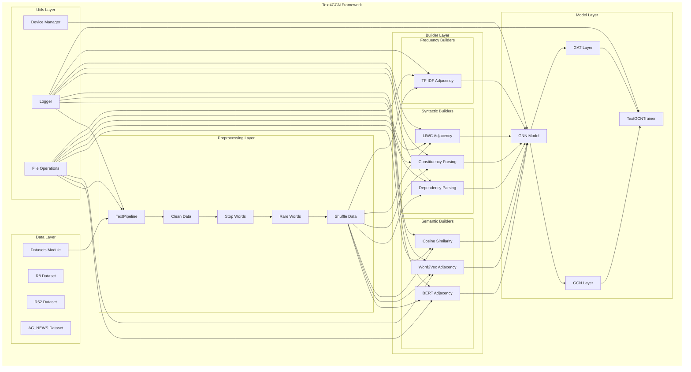
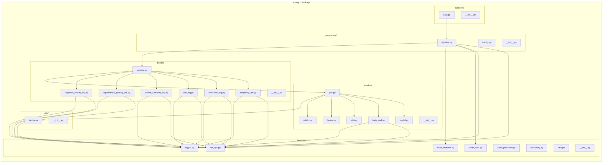
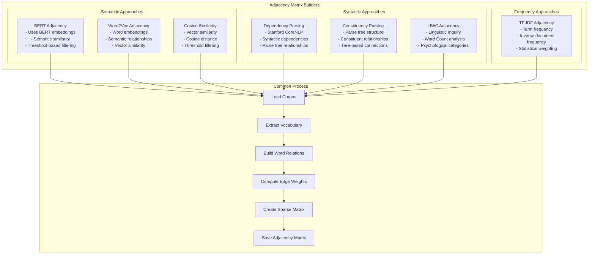
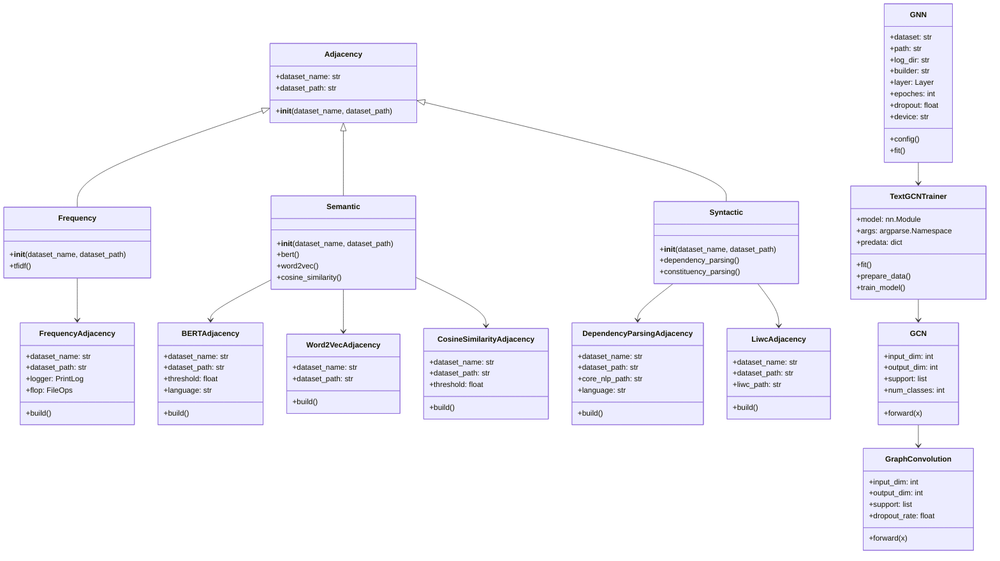

# Diagramas de Arquitetura do Text4GCN

## 1. Arquitetura Geral do Text4GCN



## 2. Integração entre Módulos



## 3. Fluxo de Dados

```mermaid
flowchart TD
    Start([Início]) --> LoadData[Carregar Dataset]
    LoadData --> TextPipeline[TextPipeline.execute()]
    
    TextPipeline --> CleanData[clean_data()]
    CleanData --> RemoveStopWords[remove_stop_words()]
    RemoveStopWords --> RemoveRareWords[remove_rare_words()]
    RemoveRareWords --> ShuffleData[shuffle_data()]
    
    ShuffleData --> ChooseBuilder{Escolher Builder}
    
    ChooseBuilder -->|Semantic| SemanticBuilder[Semantic Builder]
    ChooseBuilder -->|Syntactic| SyntacticBuilder[Syntactic Builder]
    ChooseBuilder -->|Frequency| FrequencyBuilder[Frequency Builder]
    
    SemanticBuilder --> BERTMethod[BERT Method]
    SemanticBuilder --> Word2VecMethod[Word2Vec Method]
    SemanticBuilder --> CosineMethod[Cosine Similarity Method]
    
    SyntacticBuilder --> DependencyMethod[Dependency Parsing Method]
    SyntacticBuilder --> ConstituencyMethod[Constituency Parsing Method]
    SyntacticBuilder --> LIWCMethod[LIWC Method]
    
    FrequencyBuilder --> TFIDFMethod[TF-IDF Method]
    
    BERTMethod --> BuildAdjacency[build_adjacency_matrix()]
    Word2VecMethod --> BuildAdjacency
    CosineMethod --> BuildAdjacency
    DependencyMethod --> BuildAdjacency
    ConstituencyMethod --> BuildAdjacency
    LIWCMethod --> BuildAdjacency
    TFIDFMethod --> BuildAdjacency
    
    BuildAdjacency --> CreateGNN[GNN Model Creation]
    CreateGNN --> LoadData[LoadData.load_corpus()]
    LoadData --> PrepareData[prepare_data()]
    PrepareData --> ConvertTensor[convert_tensor()]
    ConvertTensor --> TrainModel[train_model()]
    
    TrainModel --> EvaluateModel[evaluate_model()]
    EvaluateModel --> End([Fim])
```

## 4. Métodos de Construção de Adjacência



## 5. Estrutura de Classes e Herança



