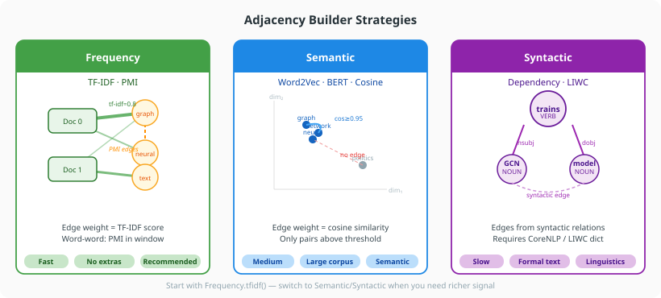

# Choosing a Builder

Text4GCN provides three families of adjacency builders. This guide helps you choose the right one for your use case.

---



## Quick comparison

| Builder | Method | Speed | Accuracy | Requires |
|---|---|---|---|---|
| `Frequency` | `tfidf()` | Fast | Good baseline | Nothing extra |
| `Semantic` | `word2vec()` | Medium | Better on large corpora | Training time |
| `Semantic` | `bert()` | Slow | Best on short texts | BERT model |
| `Semantic` | `cosine_similarity()` | Medium | Good for document similarity | Nothing extra |
| `Syntactic` | `dependency_parsing()` | Slow | Best on formal text | `text4gcn[syntactic]` + CoreNLP jars |
| `Syntactic` | `linguistic_inquiry()` | Fast | Psycholinguistic signal | LIWC dictionary |

---

## Frequency — TF-IDF (recommended start)

The TF-IDF builder is the default and the best starting point. It requires no external tools, runs quickly, and gives competitive results on standard benchmarks.

```python
from text4gcn.builder import Frequency

stats = Frequency(dataset_name="R8", dataset_path="data/").tfidf(window_size=20)
print(stats)  # GraphBuildStats: nodes, edges(nnz), density, file size
```

**Use when:**
- You are running your first experiment
- Compute time is limited
- The corpus uses standard vocabulary

**Tune:**
- `window_size` — larger windows capture longer-range co-occurrence but increase noise. Start at 20; try 10 or 30 for short/long texts.

---

## Semantic — Word2Vec

Word2Vec trains embeddings on your corpus from scratch. Words are connected if their embedding cosine similarity exceeds `threshold`. Better than TF-IDF when the corpus is large enough to train meaningful embeddings (tens of thousands of documents or more).

```python
from text4gcn.builder import Semantic

Semantic(dataset_name="R8", dataset_path="data/").word2vec(
    training_algorithm=1,   # 1=CBOW, 2=Skip-Gram
    embedding_dimension=300,
    num_epochs=20,
    threshold=0.95,
)
```

**Use when:**
- You have a large corpus (≥ 10k documents)
- Words have domain-specific meaning not captured by PMI
- You want embeddings trained on your own data

**Tune:**
- `training_algorithm` — CBOW (`1`) is faster; Skip-Gram (`2`) is better on rare words
- `threshold` — higher values (0.95+) create sparser graphs; lower values (0.80) create denser, noisier graphs

---

## Semantic — BERT

BERT embeds words using a pre-trained contextual model. Most useful for short, semantically dense texts (news headlines, tweets, biomedical abstracts).

```python
from text4gcn.builder import Semantic

Semantic(dataset_name="R8", dataset_path="data/").bert(threshold=0.95)
```

!!! note "Working in Progress"
    BERT adjacency may require additional dependencies and GPU time. Use TF-IDF or Word2Vec for quick experiments.

**Use when:**
- Short texts where individual words carry strong contextual meaning
- Domain-specific pre-trained BERT models are available

---

## Semantic — Cosine Similarity

Connects words whose TF-IDF document-vector cosine similarity exceeds the threshold. Captures document-level distributional similarity without training embeddings.

```python
from text4gcn.builder import Semantic

Semantic(dataset_name="R8", dataset_path="data/").cosine_similarity(threshold=0.90)
```

**Use when:**
- You want a non-parametric semantic measure without training Word2Vec
- Documents are long enough for TF-IDF vectors to be meaningful

---

## Syntactic — Dependency Parsing

Edges between syntactically related words (subject-verb, adjective-noun, etc.) using Stanford CoreNLP.

```python
from text4gcn.builder import Syntactic

Syntactic(dataset_name="R8", dataset_path="data/").dependency_parsing(
    core_nlp_path="/opt/stanford-corenlp",
    language="english",
)
```

!!! note "Optional dependency"
    Install with `pip install text4gcn[syntactic]` and point `core_nlp_path` at a local Stanford CoreNLP installation (Java jars).

**Use when:**
- Formal text where grammatical relations carry classification signal
- Linguistic analysis is the goal

---

## Syntactic — LIWC

Connects words that share LIWC (Linguistic Inquiry and Word Count) psycholinguistic categories (e.g. "positive emotion", "cognitive process").

```python
from text4gcn.builder import Syntactic

Syntactic(dataset_name="R8", dataset_path="data/").linguistic_inquiry(
    liwc_path="data/LIWC2015.dic",
)
```

**Use when:**
- Sentiment, affect, or psychological framing is relevant to the classification task
- You already have a LIWC dictionary licence

---

## Mixing builders

Each builder writes a separate adjacency file. You can build multiple adjacency matrices and train separate GNN models to compare:

```python
from text4gcn.builder import Frequency, Semantic
from text4gcn import GNN, Builder

dataset_name = "R8"
dataset_path = "data/"

Frequency(dataset_name=dataset_name, dataset_path=dataset_path).tfidf()
Semantic(dataset_name=dataset_name, dataset_path=dataset_path).word2vec(
    training_algorithm=1, embedding_dimension=300, num_epochs=20
)

result_tfidf = GNN(dataset_name=dataset_name, dataset_path=dataset_path, builder=Builder.Tfidf).fit()
result_w2v   = GNN(dataset_name=dataset_name, dataset_path=dataset_path, builder=Builder.Word2Vec).fit()

print(f"TF-IDF:   {result_tfidf.test_accuracy:.4f}")
print(f"Word2Vec: {result_w2v.test_accuracy:.4f}")
```

---

## Builder ↔ GNN.builder enum mapping

When calling `GNN`, pass the `builder` that matches the adjacency file you built:

```python
from text4gcn import GNN, Builder

GNN(..., builder=Builder.Tfidf)           # reads ind.frequency.tfidf.R8.adj
GNN(..., builder=Builder.Word2Vec)        # reads ind.embedding.word2vec.R8.adj
GNN(..., builder=Builder.CosineSimilarity) # reads ind.cosine.similarity.R8.adj
GNN(..., builder=Builder.DependencyParsing) # reads ind.dependency.parsing.R8.adj
GNN(..., builder=Builder.Liwc)            # reads ind.liwc.R8.adj
```
