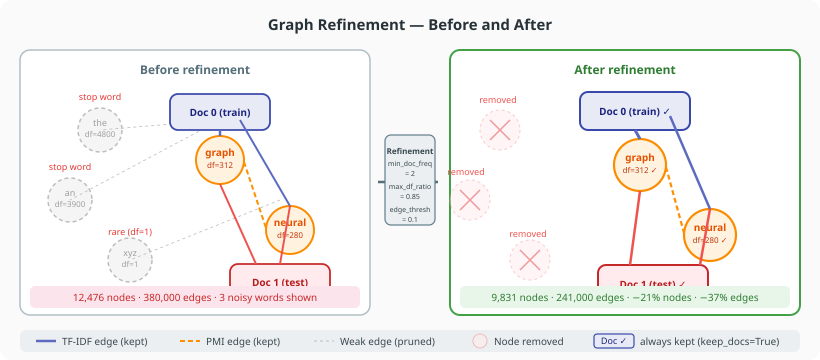

# Graph Refinement

Graph refinement reduces the word-document graph before training — removing low-quality word nodes and pruning weak edges. This can reduce training time, decrease overfitting, and sometimes improve accuracy.

For the full API reference see [`RefinementConfig`](../api/refinement.md).

---



## When to use refinement

| Symptom | Suggested filter |
|---|---|
| Training is slow due to large graph | `min_doc_freq`, `edge_weight_threshold` |
| Common function words dominate features | `stopwords`, `max_doc_freq_ratio` |
| Sparse long-tail words add noise | `min_doc_freq`, `min_word_degree` |
| Hub nodes distort neighbourhood aggregation | `max_word_degree`, `top_k_edges_per_node` |

Refinement is optional. The default `TextPipeline` already applies `rare_count` filtering; refinement lets you apply additional graph-level constraints without re-running the pipeline.

---

## Applying refinement via GNN

The simplest way is to pass a `RefinementConfig` to `GNN`. Refinement is applied after loading the corpus, before training.

```python
from text4gcn import GNN, Builder, RefinementConfig

result = GNN(
    dataset_name="R8",
    dataset_path="data/",
    builder=Builder.Tfidf,
    refinement_config=RefinementConfig(
        min_doc_freq=2,              # drop words in fewer than 2 docs
        edge_weight_threshold=0.1,   # drop very weak edges
        keep_docs=True,              # never remove document nodes
    ),
).fit()
```

---

## Filter reference

### Dropping rare words

```python
RefinementConfig(min_doc_freq=2)
```

Drops word nodes that appear in fewer than 2 documents. Equivalent to `min_df=2` in scikit-learn vectorisers.

```python
RefinementConfig(min_doc_freq=5, max_doc_freq_ratio=0.90)
```

Also drops words that appear in more than 90% of documents (equivalent to `max_df=0.90`).

---

### Dropping by node degree

```python
RefinementConfig(min_word_degree=1.0)
```

Drops word nodes whose **weighted** degree (the sum of their edge weights) is below 1.0, including isolated words.

```python
RefinementConfig(max_word_degree=5000.0)
```

Drops hub word nodes with degree above 5000 — extremely connected words that dilute neighbourhood information.

```python
RefinementConfig(min_degree=1.0, max_degree=5000.0)
```

Same test on every node's weighted degree. With `keep_docs=True` (default) document nodes are exempt, so it only drops words; with `keep_docs=False` it can drop documents too.

---

### Edge pruning

```python
RefinementConfig(edge_weight_threshold=0.05)
```

Removes all edges whose stored weight is below 0.05 — whatever the builder stored: TF-IDF for word–document edges; PMI (`tfidf()`), count / max count (RWF builders) or cosine similarity (`cosine_similarity()`) for word–word edges.

```python
RefinementConfig(top_k_edges_per_node=10)
```

Keeps only the 10 heaviest edges per node. Creates a sparser, cleaner graph. An edge survives if it is among the 10 heaviest of *either* endpoint, and keeps its original weight.

---

### Stopword filtering

```python
RefinementConfig(
    stopwords={"the", "a", "an", "is", "in", "of", "to"},
    vocab_path="data/R8.shuffled/R8.vocab",
)
```

Drops word nodes for any word in `stopwords`. The vocabulary maps word strings to vocabulary indices: `vocab_path` is optional — when it is `None`, the vocabulary is read from `<dataset_path>/<dataset_name>.shuffled/<dataset_name>.vocab`. `GNN` always passes `dataset_path` and `dataset_name`; with `apply_refinement`, pass them (or `vocab_path`) yourself, otherwise `stopwords` silently does nothing.

---

### Drop / keep by vocabulary index

```python
RefinementConfig(drop_word_indices={0, 1, 5, 100})
RefinementConfig(keep_word_indices={10, 20, 30})  # whitelist; all others dropped
```

`keep_word_indices` decides alone for word nodes: the other word filters are ignored. `min_degree` / `max_degree` still apply first.

---

### Always keep document nodes

```python
RefinementConfig(keep_docs=True)  # default
```

When `True`, document nodes (train and test) are never removed regardless of other filters. Set to `False` only if you have a specific reason to filter documents.

---

## Combining filters

All filters are applied together. Order of application:

1. Global degree filters (`min_degree`, `max_degree`)
2. Whitelist (`keep_word_indices`) — if set, it alone decides which word nodes stay and steps 3–6 are skipped
3. Word-only degree filters (`min_word_degree`, `max_word_degree`)
4. Document frequency filters (`min_doc_freq`, `max_doc_freq_ratio`)
5. Index filter (`drop_word_indices`)
6. Stopword filter (`stopwords`)
7. Edge pruning (`edge_weight_threshold`, `top_k_edges_per_node`), on the graph left after node filtering

Document nodes pass all node filters when `keep_docs=True`.

---

## Inspecting refinement statistics

Use `apply_refinement` directly with `return_metadata=True` to see what was removed:

```python
from text4gcn import RefinementConfig, apply_refinement, Builder
from text4gcn.models.utils import LoadData

predata = LoadData(
    path="data/",
    dataset="R8",
    builder=Builder.Tfidf,
).load_corpus()

config = RefinementConfig(
    min_doc_freq=3,
    edge_weight_threshold=0.05,
    keep_docs=True,
)
predata_refined, info = apply_refinement(
    predata, config, dataset_path="data/", dataset_name="R8", return_metadata=True
)

stats = info["stats"]
print(f"Nodes: {stats['nodes_original']} → {stats['nodes_refined']} ({stats['nodes_removed']} removed)")
print(f"Edges: {stats['edges_before']} → {stats['edges_after']}")
```

`edges_before` counts the edges left after node filtering, before edge pruning; `edges_after` counts them after pruning.

`info["metadata"]` holds one [`NodeMetadata`](../api/refinement.md#nodemetadata) per kept node (type, original index, degree, word or document id). Pass `build_metadata=False` to skip it; `info["metadata"]` is then `None`.

---

## Complete example

```python
from text4gcn import GNN, Builder, RefinementConfig

result = GNN(
    dataset_name="R8",
    dataset_path="data/",
    builder=Builder.Tfidf,
    epochs=200,
    early_stopping=10,
    refinement_config=RefinementConfig(
        min_doc_freq=2,
        max_doc_freq_ratio=0.85,
        edge_weight_threshold=0.05,
        top_k_edges_per_node=20,
        keep_docs=True,
    ),
).fit()

print(f"Accuracy: {result.test_accuracy:.4f}")
```
