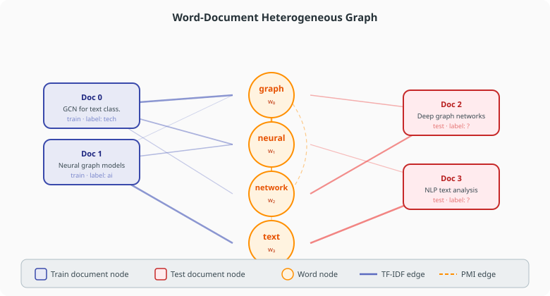
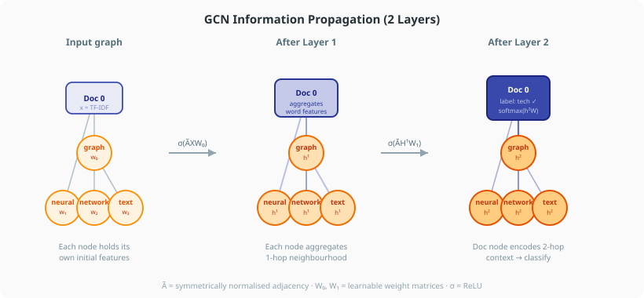

# Understanding the Text Graph

Text4GCN represents a corpus as a **heterogeneous word-document graph**. This page explains the graph structure and why it is effective for text classification.

---

## Graph structure



## Node types

The graph contains two kinds of nodes:

| Node type | Count | Represents |
|---|---|---|
| **Document nodes** | `train_size + test_size` | One node per document in the corpus |
| **Word nodes** | `vocab_size` | One node per unique word in the vocabulary |

After preprocessing, the nodes are ordered as:

```
[train_doc_0, ..., train_doc_{n-1},  word_0, ..., word_{V-1},  test_doc_0, ..., test_doc_{m-1}]
```

---

## Edge types

| Edge | Direction | Weight | Meaning |
|---|---|---|---|
| **Word ↔ Word** | Undirected | PMI score | Two words tend to co-occur in the same sliding window |
| **Word ↔ Document** | Undirected | TF-IDF score | A word appears in a document with that importance |

There are **no document-document edges** in the default graph (documents only connect through shared words).

### Word-word edges (PMI)

Pointwise Mutual Information is computed over a sliding window of size `window_size`:

```
PMI(w_i, w_j) = log( p(w_i, w_j) / (p(w_i) * p(w_j)) )
```

Only positive PMI values produce an edge.

### Word-document edges (TF-IDF)

TF-IDF measures how important a word is to a specific document relative to the whole corpus:

```
TF-IDF(w, d) = tf(w, d) * log(N / df(w))
```

where `tf(w, d)` is the term frequency in document `d`, `N` is the number of documents, and `df(w)` is the number of documents containing `w`.

---

## GCN information propagation



## Why a graph?

Bag-of-words models (TF-IDF vectors, naive Bayes) treat words independently. A graph captures **co-occurrence context**: if "neural" and "network" always appear together, the graph creates a strong edge between them and the model can leverage that signal.

GCNs propagate information along edges. A document node aggregates information from its word nodes; word nodes aggregate from both documents and co-occurring words. After two GCN layers, each document node contains a summary of:

1. Its own word content (layer 1)
2. Words that those words co-occur with (layer 2)

This is richer than a bag-of-words embedding with no structural signal.

---

## Graph size

For a corpus with `D` documents and vocabulary size `V`:

| Quantity | Size |
|---|---|
| Nodes | `D + V` |
| Word-doc edges | up to `D × V` (sparse in practice) |
| Word-word edges | bounded by PMI window; typically `O(V)` |

For the R8 benchmark (7,674 docs, ~7,000 words after filtering) the graph has ~14,700 nodes and ~300,000 edges.

---

## Inspecting the graph

After building adjacency with `Frequency(...).tfidf()`, the matrix is stored as a `scipy.sparse` file. You can load and inspect it directly:

```python
import pickle, scipy.sparse as sp

with open("data/R8.adjacency/ind.frequency.tfidf.R8.adj", "rb") as f:
    adj = pickle.load(f)

print(adj.shape)   # (14674, 14674)
print(adj.nnz)     # number of edges × 2 (symmetric)
```

Or via `apply_refinement` with `return_metadata=True` to get per-node type and degree information:

```python
from text4gcn import RefinementConfig, apply_refinement

_, info = apply_refinement(predata, RefinementConfig(), return_metadata=True)
stats = info["stats"]
print(stats)
# {'nodes_original': 14674, 'nodes_refined': 14674, ...}
```
