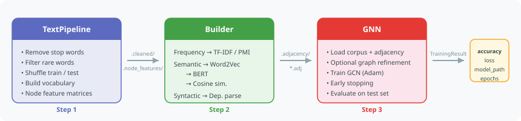

# Text4GCN

**A Python framework for text classification using Graph Neural Networks.**

[](https://opensource.org/licenses/MIT)
[](https://badge.fury.io/py/text4gcn)
[](https://www.python.org/downloads/)

---

Text4GCN converts a collection of text documents into a **word-document graph** and trains a Graph Convolutional Network (GCN) on it for document classification. The graph captures vocabulary co-occurrence patterns that traditional bag-of-words models miss.

!!! info "Scope and limitations"
    - **Scientific niche:** text-graph construction and TGCN with **Related Word Filter (RWF)** — fewer edges / less memory, accuracy ≈ classic TextGCN (Pereira & de Castro, DCAI 2022). Not a drop-in replacement for fine-tuned transformers on short-text SOTA.
    - **Transductive learning:** test documents are included in the graph at construction time (same as Yao et al., AAAI 2019). New documents require rebuilding the graph and retraining.
    - **Default protocol:** dropout 0.5, lr 0.02, hidden 200, early stopping 10, 10% of train as validation via `TextPipeline.execute(validation_ratio=0.10)`.

## How it works



The pipeline has three steps: preprocess text → build the graph → train the GCN. Each step writes files to disk so you can resume at any stage.

## Key features

- **Three adjacency strategies** — frequency (TF-IDF/PMI), semantic (Word2Vec, BERT, cosine similarity), syntactic (dependency parsing, LIWC)
- **Graph refinement** — filter low-frequency words, prune weak edges, attach node metadata
- **Automatic device selection** — detects CUDA, falls back to CPU transparently
- **Structured results** — `GNN.fit()` returns a `TrainingResult` dataclass with accuracy, loss, model path and epoch count
- **Informative errors** — if a pipeline step is missing, the error shows the exact command to fix it

## Quick start

```bash
pip install text4gcn
pip install "text4gcn[syntactic]"   # optional: Stanford CoreNLP wrapper (Java jars still required)
```

```python
from text4gcn import GNN, TextPipeline, Builder, GraphBuildStats
from text4gcn.builder import Frequency

# Step 1 — preprocess raw text (validation split + shuffle seed live here)
TextPipeline(dataset_name="R8", dataset_path="data/", seed=1234).execute(
    validation_ratio=0.10,
)

# Step 2 — build the word-document graph (returns edge/memory stats)
stats = Frequency(dataset_name="R8", dataset_path="data/").tfidf()
print(stats)  # GraphBuildStats: nodes, edges(nnz), density, file size

# Step 3 — train and evaluate
result = GNN(dataset_name="R8", dataset_path="data/", seed=1234).fit()
print(f"Test accuracy: {result.test_accuracy:.4f}")
```

!!! tip "Learn by example"
    The [tutorials](tutorials/index.md) tell the whole story in five notebooks: from a twelve-sentence graph you can see, to a real benchmark, to comparing graph builders, to your own corpus.

Reproduce DCAI 2022 Tables 2/3 (reference + optional local comparison):

```bash
python scripts/reproduce_dcai2022.py --reference-only
python scripts/reproduce_dcai2022.py --data-dir data/ --dataset R8 --builders frequency,semantic
```

## Benchmark datasets

| Dataset | Docs | Classes | Train | Test | Avg. length |
|---------|------|---------|-------|------|-------------|
| R8      | 7,674 | 8 | 5,485 | 2,189 | 65.7 |
| R52     | 9,100 | 52 | 6,532 | 2,568 | 69.8 |
| 20NG    | 18,846 | 20 | 11,314 | 7,532 | 221.3 |
| MR      | 10,662 | 2 | 7,108 | 3,554 | 20.4 |
| Ohsumed | 7,400 | 23 | 3,357 | 4,043 | 135.8 |

R8, R52, Ohsumed and PubMed: `text4gcn.datasets.download(name, path)`. 20NG: `twenty_newsgroups(path)`. Anything else: `save_corpus(...)`. See [Datasets](api/datasets.md).

## References

- Pereira & de Castro (2022) — *Natural Language Processing Based on a Text Graph Convolutional Network* (DCAI). See `papers/`.
- Yao, Mao & Luo (2019) — *Graph Convolutional Networks for Text Classification* (AAAI)
- Kipf & Welling (2017) — *Semi-supervised Classification with Graph Convolutional Networks*
