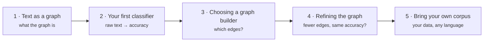

# Tutorials

Five notebooks that take you from *"what is a text graph?"* to training on your
own corpus. Each one answers the question the previous one leaves open, so
they read best in order.



| # | Tutorial | You will learn | Runtime |
|---|---|---|---|
| 1 | [Text as a graph](01_text_as_a_graph.ipynb) | What nodes and edges Text4GCN builds, and why an unlabelled document can be classified from its place in the graph | seconds, CPU |
| 2 | [Your first classifier](02_first_classifier.ipynb) | The full pipeline on the 20 Newsgroups benchmark: download, `TextPipeline`, `Frequency.tfidf()`, `GNN.fit()` | ~2 min GPU / ~6 min CPU |
| 3 | [Choosing a graph builder](03_choosing_a_graph_builder.ipynb) | TF-IDF + PMI vs. Word2Vec RWF vs. cosine similarity: edges, build time and accuracy side by side | ~25 min CPU |
| 4 | [Refining the graph](04_refining_the_graph.ipynb) | Measuring and pruning a built graph with `RefinementConfig`, and what it does to accuracy | ~30 min CPU |
| 5 | [Bring your own corpus](05_bring_your_own_corpus.ipynb) | From a DataFrame to the input files, non-English text, encodings and memory sizing | seconds, CPU |

## The story in one paragraph

TextGCN turns a corpus into **one graph** of documents and words and lets a GCN
pass labels along its edges (1). On a real benchmark that graph classifies
well, but it has **millions of edges** (2). The Related Word Filter of
Pereira & de Castro (DCAI 2022) connects only related words and keeps
comparable accuracy with **an order of magnitude fewer edges**, because the
document–word edges carry most of the signal (3). Refinement
prunes an existing graph further, without rebuilding it (4). Everything carries
over to your own data and language (5).

## Running the notebooks

Every notebook has an **Open in Colab** badge and installs `text4gcn` in its
first cell. Use a GPU runtime for tutorials 2–4 (*Runtime → Change runtime
type → T4 GPU*). To run them locally:

```bash
pip install text4gcn jupyter
jupyter lab docs/tutorials/
```
